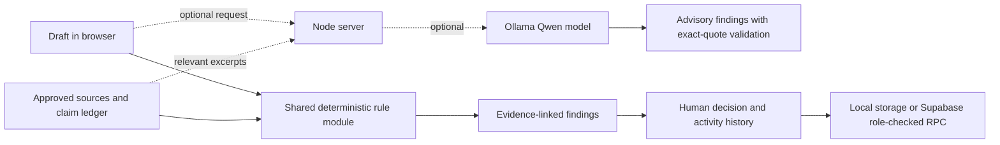

# BrandLens — Round 2 MVP

BrandLens is a pre-publication content review app for small marketing and communications teams. It checks a draft against fictional or user-supplied brand guidance, approved source excerpts, claim dates and writing rules. People decide what to change and whether to approve.


## Try it in 60 seconds

1. Install [Node.js 20+](https://nodejs.org/).
2. From this repository, run `npm start` (no dependency install is needed).
3. Open <http://localhost:3000> and select **Run review**. The fictional sample draft demonstrates an unsupported “3 days” claim against a 28-day study source.
4. Open **Facts & rules** to inspect the cited evidence. Replace the sample with your own approved facts before using the app for real content.

The hosted app can use local browser storage and deterministic rules without any external service. Ollama is optional; the review panel displays whether deterministic-only or deterministic plus the configured Ollama model is active.

## What the checks cover

Rules currently flag unsupported claim language, expired ledger entries, numeric mismatches in quantities present in an approved source (such as “3 days” versus “28-day”), restricted terminology, repeated exclamation marks, all-caps text, and long sentences. Numeric checks compare known quantities; they do not establish truth or prove that a source is complete.

## Frozen evaluation baseline

Run `npm run eval` to score the exact 40 synthetic drafts in [`eval/drafts.json`](eval/drafts.json) using the shared production rule module. The set includes 15 clean drafts and one embedded prompt-injection example. The fixtures and labels were authored by the project developer, so this is a reproducible self-check, not an independent benchmark or user study. Independent annotation is still needed. The interview question guide and reporting template are in [`docs/interview-guide.md`](docs/interview-guide.md).

| Metric | Baseline target | Current result |
|---|---:|---:|
| Micro precision | ≥ 80% | 100.0% (32 TP, 0 FP) |
| Micro recall | ≥ 70% | 100.0% (32 TP, 0 FN) |
| False alarms on clean drafts | Report | 0 / 15 (0.0%) |
| Numeric-conflict recall | Report | 100.0% (9 TP, 0 FN) |

The set is small and both rules and labels were authored by the project developer, so the perfect score reflects a self-authored smoke benchmark and is not evidence of production accuracy. The fixtures cover only a narrow range of units and wording. The 80% precision and 70% recall thresholds are initial project targets for this self-check, not externally validated acceptance criteria. Interview research completed so far: n=0.

## Architecture



## Run locally

Requirements: Node.js 20 or newer. No package install or build step is required.

```bash
npm start
```

Open <http://localhost:3000>. The demo workspace loads automatically and persists in browser local storage. Click **Run review** to see the end-to-end finding workflow. The bundled sources and claims are fictional, for demonstration only.

You can also run with Node directly:

```bash
node server.mjs
```

## Included workflow

1. Load the fictional workspace or import a `.txt` / `.md` draft.
2. Run deterministic checks for unsupported and expired claims, numeric conflicts, restricted terminology, excess exclamation marks, all-caps text and long sentences.
3. Inspect the exact draft text, the linked source, the reason and a suggested edit.
4. Accept an edit, edit the draft, escalate, dismiss a non-claim finding with a reason, or resolve a claim with a source and reason.
5. Record human approval only after every finding has a recorded decision. Approval is recorded in the audit log; the app does not publish.
6. Browse facts and rules, add approved claims, view the activity log, manage shared team access with Admin/Reviewer/Creator roles, choose Light/Dark/Dark blue themes, and export a JSON backup. Reviews are tied to the exact draft and evidence set; changing either requires a fresh review before approval.

DOCX/image parsing and automated image recognition are not included in this MVP. The text import supports plain text and Markdown, with a 30,000-character draft limit.

## Optional Supabase sync

Follow [`docs/supabase-setup.md`](docs/supabase-setup.md) for the complete dashboard, SQL, local `.env`, account, and verification steps.

The app uses Supabase Auth and role-checked RPCs for shared workspace sync, membership, and invitations. Database policies protect workspace state. Admins invite Reviewers or Creators; invitation emails must be shared out of band. Creators sync draft text, while Admins and Reviewers manage the shared findings and approval record. Revision checks prevent stale snapshots from silently overwriting newer workspace data. Use the publishable key in `SUPABASE_PUBLISHABLE_KEY`; never use a secret or service-role key in this app. If Supabase is not configured, the app continues in local browser storage mode.

## Optional Qwen review through Ollama

Set `OLLAMA_BASE_URL` and `OLLAMA_MODEL` in the server's `.env` to an Ollama endpoint and a model already available there. Leave either value blank to run deterministic checks only. The server sends the draft and source excerpts in separate data blocks and asks for advisory JSON findings. The response is ignored unless each quoted draft span appears exactly in the submitted draft. The review panel and Settings show the active mode and configured Ollama model tag. If the model fails, deterministic checks remain usable. Record a short Qwen-path demo video after configuring the actual Ollama checkpoint; the repository does not assume a model tag that has not been configured.

The model endpoint is optional. Do not expose a remote model endpoint or send confidential content until its retention and access settings have been reviewed.

## Screenshots and hosted demo

No public demo URL or verified product GIF is included yet. Add a short screen recording of the finding-card workflow after deploying and verify the URL from a clean browser session. The local flow above is available immediately.

## Deploying a public demo

The repository includes `render.yaml` for a Node web service. Connect this directory to a host that supports Node 20, deploy, and open `/api/health` to confirm the service is running. Without Supabase environment variables, each judge's browser receives its own local demo workspace. Configure Supabase only after the schema is applied and authentication is ready.

## Round 2 plan changes

- The MVP uses a small Node.js built-in HTTP server and browser JavaScript instead of introducing a frontend framework and package-install step during the short build window.
- The MVP stores a shared workspace as a JSONB snapshot in Supabase. Admin, Reviewer, and Creator membership is role-checked by database RPCs and row-level security; local mode uses browser storage.
- MVP imports `.txt` and `.md`; DOCX parsing, image/alt-text accessibility checks, guideline-insights page, automated visual checks, and richer integrations are deferred. The current MVP does not claim to implement those Round 1 plan items.
- The model call is optional and server-side. Deterministic rules are the reliable baseline.

## Round 3 improvements

1. Evidence-backed claim ledger with source ownership, version history, expiry alerts and reviewer substantiation.
2. Guideline-health insights that surface repeated dismissals, overrides and conflicting rules for owner review.
3. Minimal-diff, intent-preserving rewrites with clearer span highlighting and per-change review.

## Security and limitations

- The bundled workspace is fictional and contains no real brand data.
- Local storage is limited to the current browser profile and is not encrypted by this app.
- Cloud accounts use Supabase Auth, shared workspace membership, role-checked write RPCs, and row-level security. Invites are recorded in Supabase but not emailed automatically.
- Model output is advisory, checked against the submitted draft, and never approves or publishes.
- Deterministic checks can miss claims or raise false alarms; the initial author-labeled evaluation is small and not independently validated. A human reviewer remains responsible.
- This MVP is not legal advice and does not establish that a claim is true.
