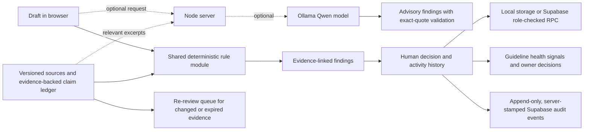

# BrandLens — Codex 48 Round 3 build

BrandLens is a pre-publication content review app for small marketing and communications teams. It checks a draft against fictional or user-supplied brand guidance, approved source excerpts, claim dates and writing rules. People decide what to change and whether to approve.


## Try it in 60 seconds

1. Install [Node.js 20+](https://nodejs.org/).
2. From this repository, run `npm start` (no dependency install is needed).
3. Open <http://localhost:3000> and select **Run review**. The fictional sample draft demonstrates an unsupported “3 days” claim against a 28-day study source.
4. Open **Facts & rules** to inspect the cited evidence. Replace the sample with your own approved facts before using the app for real content.

The hosted app can use local browser storage and deterministic rules without any external service. Ollama is optional; the review panel displays whether deterministic-only or deterministic plus the configured Ollama model is active.

## What the checks cover

Rules currently flag unsupported claim language, expired ledger entries, numeric mismatches in quantities present in an approved source (such as “3 days” versus “28-day”), restricted terminology, repeated exclamation marks, all-caps text, and long sentences. Numeric checks compare known quantities; they do not establish truth or prove that a source is complete.

## Frozen evaluation baseline

Run `npm run eval` to score the exact 40 synthetic drafts in [`eval/drafts.json`](eval/drafts.json) using the shared production rule module. The set includes 15 clean drafts and one embedded prompt-injection example. The fixtures and labels were authored by the project developer, so this is a reproducible self-check, not an independent benchmark or user study. Independent annotation is still needed. The interview question guide and reporting template are in [`docs/interview-guide.md`](docs/interview-guide.md).

| Metric | Baseline target | Current result |
|---|---:|---:|
| Micro precision | ≥ 80% | 100.0% (32 TP, 0 FP) |
| Micro recall | ≥ 70% | 100.0% (32 TP, 0 FN) |
| False alarms on clean drafts | Report | 0 / 15 (0.0%) |
| Numeric-conflict recall | Report | 100.0% (9 TP, 0 FN) |

The set is small and both rules and labels were authored by the project developer, so the perfect score reflects a self-authored smoke benchmark and is not evidence of production accuracy. The fixtures cover only a narrow range of units and wording. The 80% precision and 70% recall thresholds are initial project targets for this self-check, not externally validated acceptance criteria. Interview research completed so far: n=0.

## Architecture



## Run locally

Requirements: Node.js 20 or newer. No package install or build step is required.

```bash
npm start
```

Open <http://localhost:3000>. The demo workspace loads automatically and persists in browser local storage. Click **Run review** to see the end-to-end finding workflow. The bundled sources and claims are fictional, for demonstration only.

You can also run with Node directly:

```bash
node server.mjs
```

## Included workflow

1. Load the fictional workspace or import a `.txt` / `.md` draft.
2. Run deterministic checks for unsupported and expired claims, numeric conflicts, restricted terminology, excess exclamation marks, all-caps text and long sentences.
3. Inspect the exact draft text, the linked source, the reason and a suggested edit.
4. Inspect a ledger-backed word-level rewrite, accept or reject it individually, then rerun deterministic checks. Unsafe or unsupported replacements are withheld.
5. Escalate, dismiss a non-claim finding with a reason, or resolve a claim finding with a source and reason.
6. Record a human approval only after every finding has a disposition. Approval stores the exact draft and its source/claim versions; the app does not publish.
7. Track claim owner, exact supporting excerpt, extracted key values, source version and expiry. Source edits or expiry put dependent claims and past approvals into the re-review queue.
8. Review repeated dismissals, overrides, escalations and possible guideline conflicts. An Admin can record “clarify”, “add exception” or “retire” with a rationale; BrandLens never changes policy automatically.
9. Browse facts and rules, manage shared team access with Admin/Reviewer/Creator roles, choose Light/Black/Dark blue themes, and export a JSON backup. Changing a draft or evidence invalidates its current review.

DOCX/image parsing and automated image recognition are not included in this MVP. The text import supports plain text and Markdown, with a 30,000-character draft limit.

## Optional Supabase sync

Follow [`docs/supabase-setup.md`](docs/supabase-setup.md) for the complete dashboard, SQL, local `.env`, account, and verification steps.

The app uses Supabase Auth and role-checked RPCs for shared workspace sync, membership, invitations, and append-only audit events. Database policies protect workspace state. Admin invitations use random 256-bit codes: only the SHA-256 digest is stored, codes are single-use and expire after seven days, and the raw code appears once for private sharing. Existing pending invites must be reissued after the schema migration. Creators sync draft text, while Admins and Reviewers manage evidence, findings, and approvals. Revision checks prevent stale snapshots from silently overwriting newer workspace data. Shared audit event authors and timestamps are assigned by the database; snapshot saves cannot rewrite the audit history, and only Admins can append workspace invite/removal events. Use the publishable key in `SUPABASE_PUBLISHABLE_KEY`; never use a secret or service-role key in this app. Reapply the current [`supabase/schema.sql`](supabase/schema.sql) before using invitation codes or the append-only audit stream. If Supabase is not configured, the app continues in local browser storage mode.

## Optional Qwen review through Ollama

Set `OLLAMA_BASE_URL` and `OLLAMA_MODEL` in the server's `.env` to an Ollama endpoint and a model already available there. Leave either value blank to run deterministic checks only. The server sends the draft and source excerpts in separate data blocks and asks for advisory JSON findings. The response is ignored unless each quoted draft span appears exactly in the submitted draft. The review panel and Settings show the active mode and configured Ollama model tag. If the model fails, deterministic checks remain usable. The hosted demo currently runs without a configured Ollama checkpoint; no video is required by the official event page.

The optional AI route rejects JSON bodies above 256,000 bytes, drafts above 30,000 characters, more than 20 sources, source titles above 200 characters, source content above 12,000 characters, or aggregate source text above 150,000 characters. Oversized bodies are rejected as soon as the byte limit is crossed and the connection is closed; request headers and bodies also have 10-second and 30-second timeouts. Ollama generation is capped at 512 tokens and its response body at 1,000,000 bytes. The route allows 12 accepted requests per 60 seconds and at most two simultaneous model calls per Node process. These usage limits are process-wide, not per account or IP; deployments with multiple app instances need a shared limiter to enforce a deployment-wide quota. Rejected AI calls leave the deterministic review intact.

Optional model tone rewrites are shown only after quote, protected-name/link/number, and deterministic re-review checks. Model output cannot generate or rewrite a claim. The model endpoint is optional. Do not expose a remote model endpoint or send confidential content until its retention and access settings have been reviewed.

## Hosted demo and repository

- Demo: <https://brandlens-round2.onrender.com>
- Repository: <https://github.com/HariomSThakur/Brandlens>
- Round 3 submission notes: [`docs/round3-submission.md`](docs/round3-submission.md)

Confirm the live deploy includes the latest commit and apply the current Supabase schema before using shared accounts. The deterministic demo can be used without sign-in.

## Deploying a public demo

The repository includes `render.yaml` for a Node web service. Connect this directory to a host that supports Node 20, deploy, and open `/api/health` to confirm the service is running. Without Supabase environment variables, each judge's browser receives its own local demo workspace. Configure Supabase only after the schema is applied and authentication is ready.

## Round 2 plan changes

- The MVP uses a small Node.js built-in HTTP server and browser JavaScript instead of introducing a frontend framework and package-install step during the short build window.
- The shared workspace still uses a JSONB snapshot for the MVP. Admin, Reviewer, and Creator membership is role-checked by database RPCs and row-level security; cloud audit events use a separate append-only table. Local mode uses browser storage.
- DOCX/image parsing, image alt-text checking, automatic invitations, workspace switching, and multi-language review remain deferred. Text import supports `.txt` and `.md`, with a 30,000-character draft limit.
- The model call is optional and server-side. Deterministic rules are the reliable baseline.

## Round 3 improvements delivered in this build

1. **Evidence-backed claim lifecycle:** claims store an owner, source version, exact excerpt, extracted values, alternative wording and review date. Source versions are retained. Source changes, claim expiry or source expiry put dependent claims and historical approvals in the re-review queue. Past approval snapshots remain unchanged; users load the draft, run it again, and record a new human approval.
2. **Guideline-health insights:** the app groups repeated finding dismissals, accepted edits and escalations; detects incompatible numeric thresholds across guidance and approved claims that use terms restricted by a guideline; shows source excerpts and outcome examples; and records an Admin decision with a rationale. Follow-up dismissal rate is reported after a decision when later outcomes exist. No rule is changed automatically.
3. **Verified minimal-diff rewrites:** replacements come from a guideline's explicit terminology mapping or an approved claim alternative. Optional model tone text is advisory. Links, names and non-claim numbers are protected, claim numbers must occur in the exact support excerpt, and the entire draft is rechecked before showing an edit. Each change is accepted or rejected separately and stored in revision history.

### Verification notes

- `npm test`: 10 focused Node tests cover quantity extraction, source-version and expiry queues, historical approval invalidation when a source or claim changes, conflicting rules, repeated outcomes and follow-up rates, safe rewrites, protected values, and word diffs.
- `npm run eval`: the original 40 author-labeled fixtures produce the same baseline as Round 2: micro precision 100.0%, recall 100.0%, and 0 false alarms across 15 clean drafts. This is a self-authored smoke benchmark, not independent validation or a real-world accuracy estimate.
- Automated local HTTP/browser smoke testing was blocked in the build environment because its socket policy denied loopback access. A live Supabase account/database run is also required to verify the append-only RPC against the owner's project after applying the updated schema.
- User interviews: n=0. The dataset and demo brand are fictional.

## Security and limitations

- The bundled workspace is fictional and contains no real brand data.
- Local storage is limited to the current browser profile and is not encrypted by this app.
- Cloud accounts use Supabase Auth, shared workspace membership, role-checked write RPCs, and row-level security. Invites are recorded in Supabase but not emailed automatically; the Admin must privately share the one-time code. Old pending invites need reissuing after the invitation-code migration.
- Invitation tokens contain 256 bits of randomness, are stored only as SHA-256 digests, expire after seven days, and are consumed on successful redemption. Existing members and the first Admin do not need a code.
- The optional Ollama route has a 256,000-byte request cap, limits on draft/source counts and text, a 512-token generation cap, a 1,000,000-byte response cap, a 12-request rolling one-minute quota, and two concurrent calls per process. The quota is global to that process and is not a per-user fairness control.
- Model output is advisory, quote-checked and re-reviewed deterministically; claim rewrites must come from the approved claim ledger. Models never approve or publish.
- Deterministic checks can miss claims or raise false alarms; the initial author-labeled evaluation is small and not independently validated. A human reviewer remains responsible.
- This MVP is not legal advice and does not establish that a claim is true.
